<div align="center">

# 🏡 California Housing Price Prediction — MLOps

**From notebook to a monitored, CI/CD-gated ML system: predicting neighbourhood median house values with tuned XGBoost (R² 0.868), designed for AWS SageMaker.**

[](https://www.python.org/)
[](notebooks/)
[](https://pandas.pydata.org/)
[](https://scikit-learn.org/)
[](https://xgboost.ai/)
[](docs/ml-system-design.md)
[](https://github.com/bharath-ts/msaai-540-mlops/actions/workflows/ci.yml)
[](LICENSE)
[](#-team--credits)

[Problem](#-problem) · [Architecture](#-architecture) · [Results](#-results) · [Quickstart](#-quickstart) · [Design doc](docs/ml-system-design.md)

</div>

---

## 🎯 Problem

Area valuations are slow, manual and inconsistent. This project asks: **can a model estimate the median house value of a California census block group accurately enough to be a repeatable, first-pass valuation tool?**

- **Data:** California Housing (1990 US census) — 20,640 block groups, 9 predictors + target `median_house_value` (censored at $500,001).
- **Task:** supervised regression · **Metrics:** MAE, MSE, RMSE, R² · **Success criteria:** R² ≥ 0.85, MAE ≤ 15% of mean price, test within a few % of CV.
- **Beyond the model:** a production design on AWS SageMaker — Feature Store, Pipelines, Model Registry, endpoints, Model Monitor/Clarify and gated CI/CD ([design doc](docs/ml-system-design.md)).

> ⚠️ Non-goals: not an appraiser, not for individual homes or lending decisions, no forecasting, no values above the $500,001 cap.

## 🏗️ Architecture

Solid boxes are **implemented in the notebooks**; dashed boxes are the **SageMaker production design** documented in [`docs/ml-system-design.md`](docs/ml-system-design.md) (not yet in this repo).

```mermaid
flowchart LR
    subgraph NB["✅ Implemented — notebooks (scikit-learn + XGBoost)"]
        A["housing.csv<br/>20,640 × 10"] --> B["Cleaning & checks<br/>nulls · duplicates · caps"]
        B --> C["Feature engineering<br/>3 ratios + 3 haversine distances"]
        C --> D["Stratified 80/20 split<br/>by income band"]
        D --> E["Pipelines<br/>impute · log1p · scale · one-hot"]
        E --> F["Train 6 models<br/>5-fold CV"]
        F --> G["RandomizedSearchCV<br/>XGBoost & Random Forest"]
        G --> H["Test-set evaluation<br/>MAE · MSE · RMSE · R²<br/>capped vs uncapped · permutation importance"]
        H --> I["predict_price()<br/>best model: tuned XGBoost"]
    end

    subgraph AWS["☁️ Designed — AWS SageMaker (docs only)"]
        S3[("S3 raw data<br/>versioned · SSE-KMS")] --> PJ["Processing job<br/>validation rules"]
        PJ --> FS[("Feature Store<br/>raw + engineered groups")]
        FS --> TJ["Training + Automatic<br/>Model Tuning"]
        TJ --> QG{"Quality gate<br/>R² ≥ 0.85"}
        QG -- pass --> MR[("Model Registry<br/>pending → approved")]
        QG -- fail --> STOP["Stop · alert via SNS"]
        MR --> EP["Real-time endpoint<br/>+ Batch Transform"]
        EP --> MON["Model Monitor · Clarify<br/>CloudWatch alarms"]
        MON -. drift alert .-> PIPE
        PIPE["SageMaker Pipelines<br/>CI/CD trigger: GitHub Actions / CodePipeline"] -.-> PJ
    end

    A -.-> S3
    C -.-> FS
    G -.-> TJ
    H -.-> QG
    I -.-> EP

    classDef planned stroke-dasharray: 5 5,fill:#fff7e6,stroke:#FF9900;
    class S3,PJ,FS,TJ,QG,MR,STOP,EP,MON,PIPE planned;
```



<details>
<summary>📊 Notebook workflow (stages 1–9)</summary>


</details>

## 📈 Results

Held-out test set (4,128 block groups), from [`notebooks/01_house_price_regression.ipynb`](notebooks/01_house_price_regression.ipynb):

| Model | MAE ($) | RMSE ($) | R² |
|---|---:|---:|---:|
| 🥇 **XGBoost (tuned)** | **26,882** | **41,441** | **0.868** |
| XGBoost | 27,654 | 41,991 | 0.865 |
| Random Forest (tuned) | 28,335 | 43,565 | 0.854 |
| Random Forest | 28,772 | 44,340 | 0.849 |
| Gradient Boosting | 30,010 | 44,508 | 0.848 |
| Decision Tree | 38,240 | 55,881 | 0.760 |
| Linear Regression (baseline) | 45,292 | 61,938 | 0.706 |
| Linear Regression (log target) | 44,723 | 83,531 | 0.465 |

| Success criterion | Target | Achieved | |
|---|---|---|:-:|
| R² | ≥ 0.85 | 0.868 | ✅ |
| MAE | ≤ 15% of mean price | 13.0% of mean price | ✅ |
| CV vs test | within a few % | CV RMSE 43,664 → test 41,441 | ✅ |
| Capped rows (n = 179) | report separately | RMSE 80,827 vs 38,717 below cap | ⚠️ limitation |

**Key takeaways**
- Tuned XGBoost cuts MAE by **41%** and RMSE by **33%** versus the linear baseline; CV and test rankings match — no sign of overfitting.
- `median_income`, longitude and latitude drive price; engineered `dist_nearest_city_km` is the strongest negative correlate (r = −0.433).
- Error roughly doubles on rows at the $500,001 cap — the model cannot learn above the censoring point.

<p align="center">
  
</p>

<details>
<summary>More figures</summary>

| | |
|---|---|
|  |  |
|  |  |

</details>

## 🗂️ Repository structure

```text
msaai-540-mlops/
├── .github/workflows/ci.yml        # pytest on every push / PR
├── data/
│   └── README.md                   # how to get housing.csv (not committed)
├── docs/
│   ├── ml-system-design.md         # ML system design (Markdown)
│   └── ML_System_Design.docx       # original design document
├── images/                         # figures exported from notebook 01
├── notebooks/
│   ├── 01_house_price_regression.ipynb     # executed run — source of all reported results
│   └── 02_house_price_regression_v2.ipynb  # refined, Colab-ready version (unexecuted)
├── src/
│   └── features.py                 # add_features() / haversine_km() shared by training & serving
├── tests/
│   └── test_features.py            # unit tests for feature engineering
├── pyproject.toml                  # pytest config
├── requirements.txt
├── LICENSE                         # Apache 2.0
└── README.md
```

## 🚀 Quickstart

```bash
git clone https://github.com/bharath-ts/msaai-540-mlops.git
cd msaai-540-mlops
python -m venv .venv && source .venv/bin/activate      # Windows: .venv\Scripts\activate
pip install -r requirements.txt

# get the data (see data/README.md) and link it next to the notebooks
curl -L -o data/housing.csv https://raw.githubusercontent.com/ageron/handson-ml2/master/datasets/housing/housing.csv
ln -s ../data/housing.csv notebooks/housing.csv

pytest -q                     # feature-engineering unit tests
jupyter lab notebooks/
```

### Running the notebooks

| Notebook | What it does | Notes |
|---|---|---|
| [`01_house_price_regression.ipynb`](notebooks/01_house_price_regression.ipynb) | Full 9-stage workflow: cleaning → EDA → features → 6 models with 5-fold CV → tuning → test evaluation → `predict_price()` | Run top-to-bottom (*Run All*). XGBoost tuning (15 iters × 3 folds) takes a few minutes on a laptop. |
| [`02_house_price_regression_v2.ipynb`](notebooks/02_house_price_regression_v2.ipynb) | Same workflow, refactored: auto-locates `housing.csv` (or Colab upload), adds Sacramento to distance features, saves `best_house_price_model.joblib`, auto-generates the results table | Set `FAST_MODE = True` in the first code cell for a quick run. Numbers may differ slightly from notebook 01. |

**Predict for a new area** (after running either notebook):

```python
predict_price(-122.25, 37.85, 30, 2500, 500, 1200, 450, 5.5, "NEAR BAY")
# notebook 01 → Estimated median house value: $268,218
```

## 🔭 Roadmap (from the design doc)

- [ ] SageMaker Pipelines DAG: validate → process → train/tune → evaluate → quality gate → register → staging → promote
- [ ] Feature Store groups `housing-raw-features` / `housing-engineered-features`
- [ ] Real-time endpoint + Batch Transform with canary rollout & rollback
- [ ] Model Monitor (data quality, drift, model quality) + Clarify bias reports
- [ ] Spatial cross-validation, SHAP, prediction intervals / censored-target model

## ⚖️ Limitations & responsible use

Predictions are **block-group medians from 1990 data**, censored at $500,001. Location features can proxy for protected attributes — use only for screening with human review. See [§3 and §5 of the design doc](docs/ml-system-design.md#3-security-checklist-risks-and-ethics).

## 👥 Team & credits

**MSAAI-540 — Machine Learning Operations** · _&lt;University / term — fill in&gt;_

| Name | Role |
|---|---|
| Bharath T S ([@bharath-ts](https://github.com/bharath-ts)) | _&lt;role&gt;_ |
| _&lt;Teammate&gt;_ | _&lt;role&gt;_ |
| _&lt;Teammate&gt;_ | _&lt;role&gt;_ |

Dataset: California Housing, 1990 US Census (Pace & Barry, 1997), as distributed with *Hands-On Machine Learning* (A. Géron).

## 📄 License

Released under the [Apache License 2.0](LICENSE).
